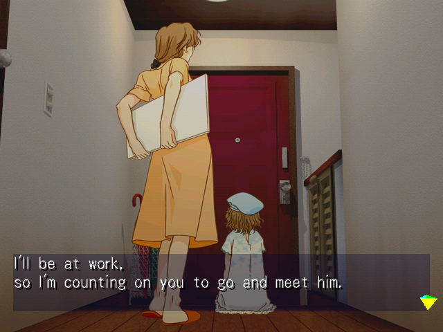
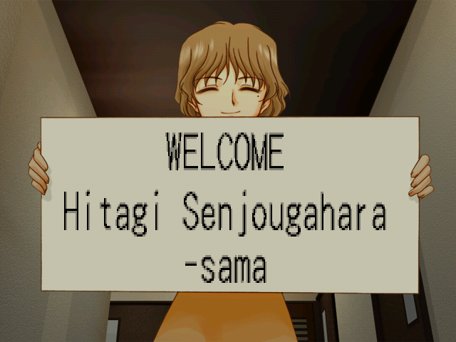
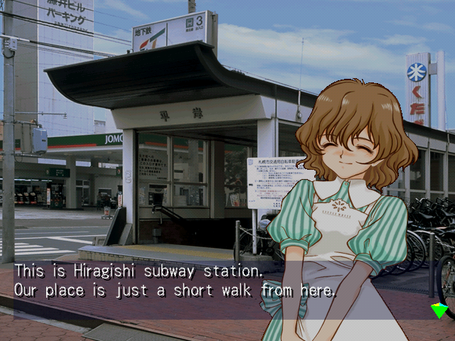
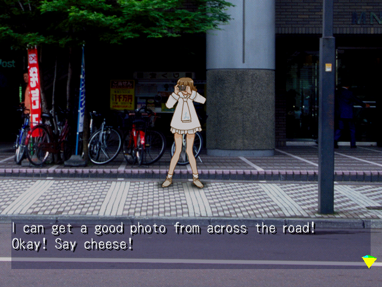
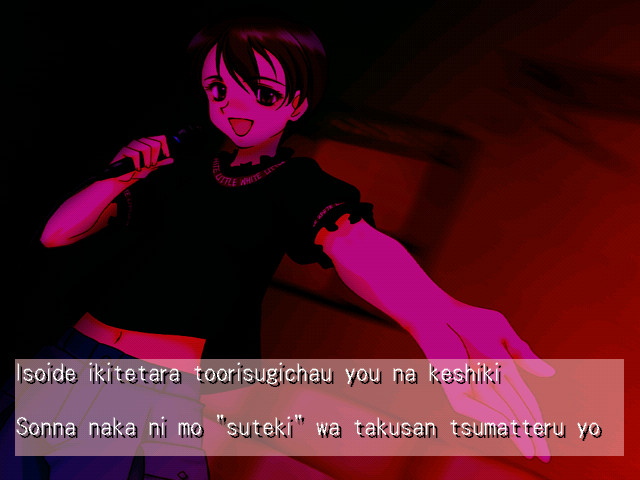
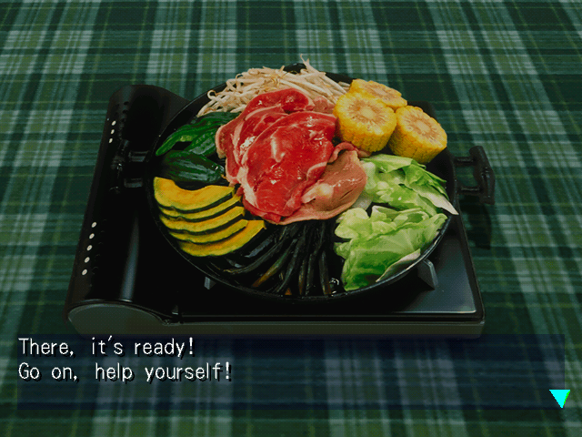
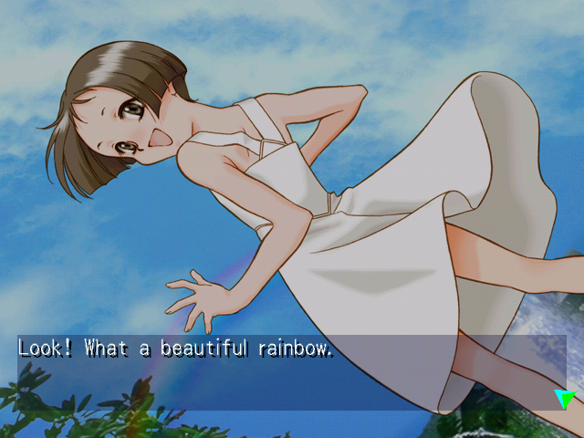
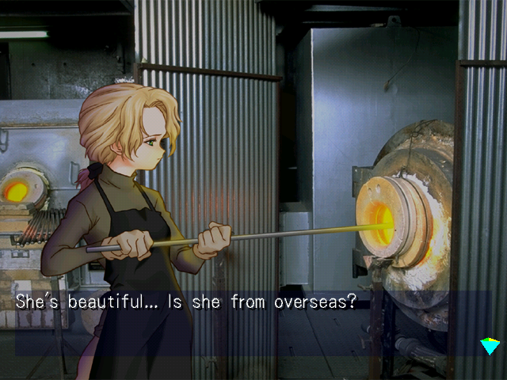

# Kita e. White Illumination English Patch

English translation patch for *Kita e. White Illumination* on the Sega Dreamcast.

HUMAN TL IS IN THE WORKS

**[Download v1.0 - patch and player's guide](https://github.com/RulevoiBanan/kita-e-white-illumination-english-patch/releases/download/v1.0/Kita.E.White.Illumination.ENG.patch.v1.0.zip)**

> **The game is not included.** This ZIP contains the English translation patch, the player's guide and a plain-text README. You must obtain your own copy of the original Japanese Dreamcast game.

## Installation

1. Download and extract the release ZIP.
2. Download and open the latest version of [Universal Dreamcast Patcher](https://github.com/DerekPascarella/UniversalDreamcastPatcher).
3. In the **Apply Patch** tab, select your unmodified Japanese game image under **Source disc image** and the extracted `.dcp` file under **Patch file**.
4. Choose an **Output folder** and the **Patched disc image format**, then click **Apply Patch** and wait for it to finish.

## Screenshots

  
  

  
  

  
  

  
  

## Release changelog

v1.0 Initial release

## What's Changed

The original release ran conversations in auto mode. The English patch changes dialogue advancement to manual, using A.

Press UP during a conversation to open the dialogue log.

Horror Sound now has subtitles to accompany the narration.

## What's not translated

- The opening message in Guardian Wing mini-game.
- The game's credits.

## Credits

- Graphics, editing, playtesting - Palevo
- Coding and translation - Codex
